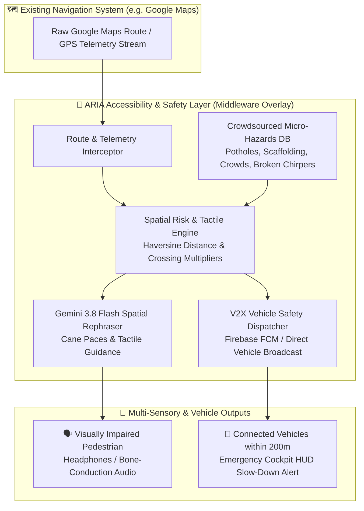

# 🦾 ARIA – Accessible Routing & Intelligent Alerts

> **The Universal Accessibility & Safety Intelligence Layer for Google Maps and Urban Mapping Systems.**  
> ARIA is **not a standalone navigation app**—it is a **plug-and-play middleware overlay / SDK** that operates directly inside or on top of any existing map provider (Google Maps, Apple Maps, Mapbox, or OEM Navigation SDKs). It enriches standard mapping with crowdsourced micro-hazard detection, cane-aware tactile audio guidance, and Vehicle-to-Everything (V2X) pedestrian safety alerts.

---

## 🌟 The Layer Concept: Why ARIA Sits Inside Google Maps

Standard navigation apps like Google Maps are built for sighted users. They assume the pedestrian can see road obstacles, spot construction scaffolding, and watch for turning vehicles.

**ARIA operates as an assistive intelligence layer directly on top of Google Maps:**



---

## 🔄 How the ARIA Layer Works: Before & After

| Feature | Standard Google Maps (Without ARIA) | Google Maps + ARIA Intelligence Layer |
| :--- | :--- | :--- |
| **Sidewalk Hazards** | Blind to sidewalk potholes, scaffolding, discarded scooters, and puddles. | **Detects & warns** in cane paces (e.g., *"Pothole 12 paces ahead near right curb, sweep cane left"*). |
| **Spoken Instructions** | Sighted visual cues: *"Turn right at the blue building"* or *"In 100 feet, turn left"*. | **Tactile & acoustic cues**: *"In 35 paces, turn right at the acoustic chirp signal. Sweep cane along tactile paving strip."* |
| **Crosswalk Safety** | Pedestrian is invisible to oncoming vehicles. | **Dispatches V2X warnings** to nearby vehicles: *"CAUTION: Slow down, blind pedestrian crossing ahead."* |
| **Integration** | Standalone mapping. | **Pluggable SDK & REST API** that wraps Google Maps JSON responses or active GPS pings. |

---

## 📂 Project Structure

```text
aria( hacka idea)/
│
├── aria_layer.py         # 🧠 Core ARIA Intelligence Layer (Middleware & Route Interceptor)
├── layer_demo.py         # 🚀 Demonstration showing Google Maps routes augmented by ARIA
├── api_server.py         # 🌐 FastAPI Middleware Server for mobile/web Google Maps integration
│
├── config.py             # Configuration loader, API keys & environment settings
├── gemini_api.py         # Google Gemini integration (gemini-3.8-flash for spatial tactile cues)
├── voice_interface.py    # Screenless voice interface (SpeechRecognition + PyTTSx3 audio)
├── maps_navigation.py    # Google Maps Directions API & live OpenStreetMap foot routing
├── society_inputs.py     # Crowdsourced micro-hazard database & Haversine proximity matcher
├── risk_engine.py        # Safety risk scoring and tactile warning generator
├── vehicle_alerts.py     # FCM / V2X alert dispatcher for surrounding vehicles
│
├── main.py               # Complete interactive terminal runner & CLI menu
├── Aria.py               # Backwards-compatible runner matching original project spec
├── test_aria.py          # Automated verification test suite (8/8 tests pass)
├── web_dashboard.py      # Streamlit interactive visual live map & vehicle cockpit HUD
│
├── run_aria.bat          # Single-click launcher for terminal interaction
├── run_dashboard.bat     # Single-click launcher for the visual web dashboard
├── society_alerts.json   # Persistent crowdsourced hazard storage
├── .env.example          # Environment template for API keys
├── .env                  # Local environment configuration
└── requirements.txt      # Python dependencies
```

---

## 💻 Developer Integration: Using ARIA as a Layer

You can embed ARIA inside any Python app, Google Maps pipeline, or navigation service in 3 lines of code:

```python
from aria_layer import AriaLayer

# 1. Initialize the ARIA Layer
layer = AriaLayer()

# 2. Intercept and augment any Google Maps route
raw_google_maps_route = google_maps_client.directions("Times Square", "Hospital", mode="walking")
accessible_route = layer.augment_google_maps_route(raw_google_maps_route)

# 3. Process live GPS telemetry as the user walks inside Google Maps
gps_event = layer.process_live_telemetry(lat=40.7592, lng=-73.9849)
if gps_event["spoken_advisory"]:
    print(gps_event["spoken_advisory"])      # Spoken audio to blind pedestrian
if gps_event["vehicle_alert_dispatched"]:
    print("V2X warning sent to nearby cars") # Emergency brake/slow alert to cars
```

---

## 🌐 REST API Endpoints (For Mobile & Web Google Maps Integration)

Start the ARIA middleware API server:
```bash
python api_server.py
```

- **`POST /api/v1/augment-route`**: Accepts standard Google Maps route JSON and returns route augmented with micro-hazards, risk scores, and tactile audio directions.
- **`POST /api/v1/telemetry-ping`**: Accepts live GPS pings from Google Maps Navigation and triggers real-time tactile warnings and vehicle alerts.
- **`POST /api/v1/report-hazard`**: Crowdsourcing endpoint to report new potholes, scaffolding, or crowds.
- **`GET /api/v1/hazards`**: Returns active micro-hazards in the overlay layer.
- **`GET /api/v1/vehicle-alerts`**: Live feed of safety alerts dispatched to vehicles.

---

## ▶️ Execution & Testing

### 1. Run the Layer Demonstration (Before vs. After Google Maps)
```bash
python layer_demo.py
```

### 2. Run the Full Interactive System
```bash
python main.py
```
*(Or double-click `run_aria.bat` on Windows)*

### 3. Launch the Interactive Visual Map & Vehicle Cockpit HUD
```bash
python -m streamlit run web_dashboard.py
```
*(Or double-click `run_dashboard.bat` on Windows)*

### 4. Run the Automated Test Suite
```bash
python test_aria.py
```
*(Validates all 8 subsystems in under 4 seconds)*

---

## 🛠️ Tech Stack

- **Core**: Python 3.10+
- **Host Mapping**: Google Maps Directions & Geocoding API / OpenStreetMap OSRM
- **Spatial Reasoning AI**: Google Gemini API via official `google-genai` SDK (`gemini-3.8-flash`)
- **Voice & Speech**: `pyttsx3` (Windows SAPI5 offline audio), `SpeechRecognition`, `PyAudio`
- **Vehicle V2X**: Firebase Cloud Messaging (FCM) & Real-time V2X broadcast bus
- **Middleware API**: FastAPI & Uvicorn
- **Visualizer**: Streamlit & Folium
